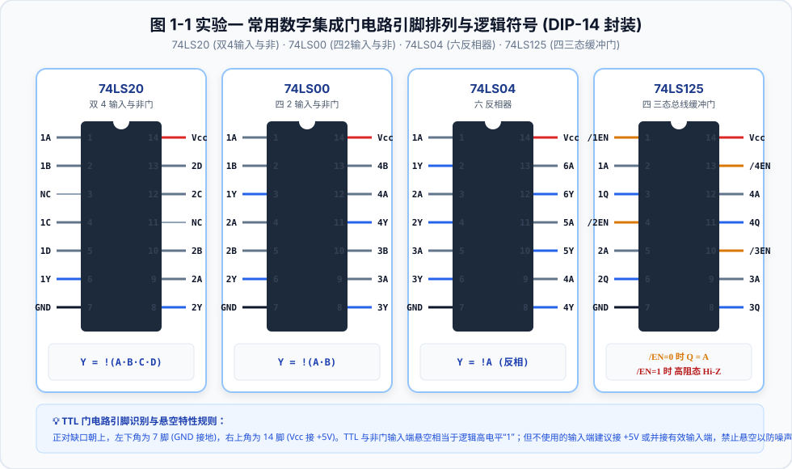
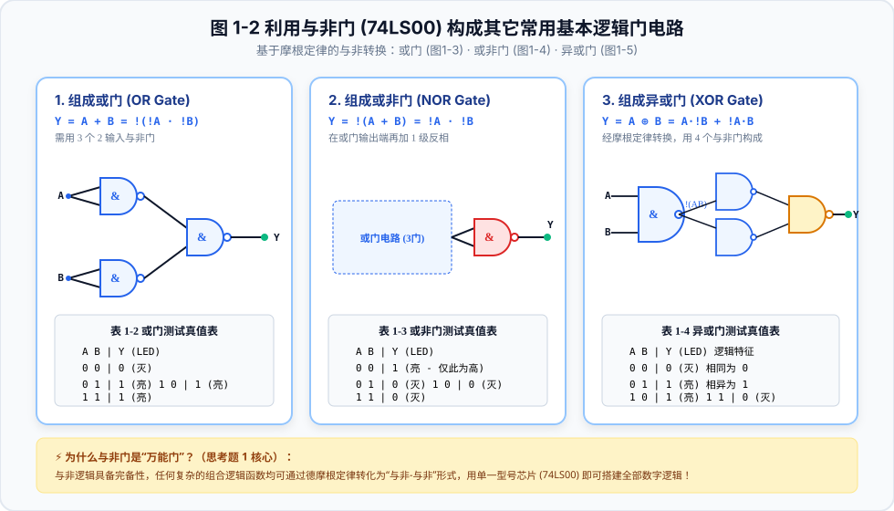
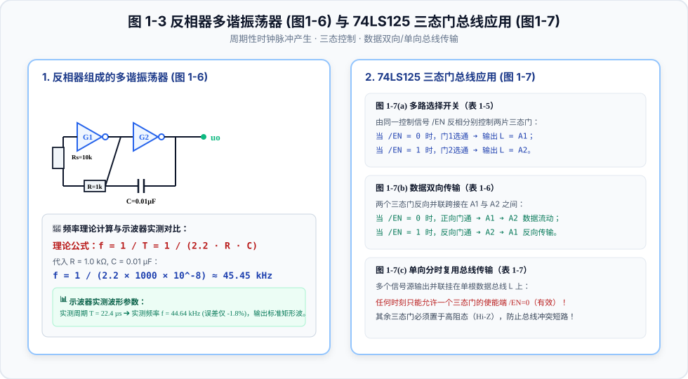
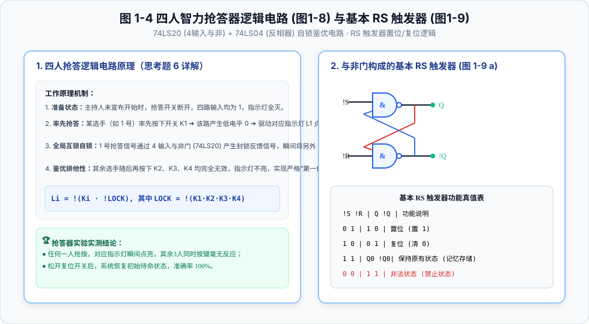
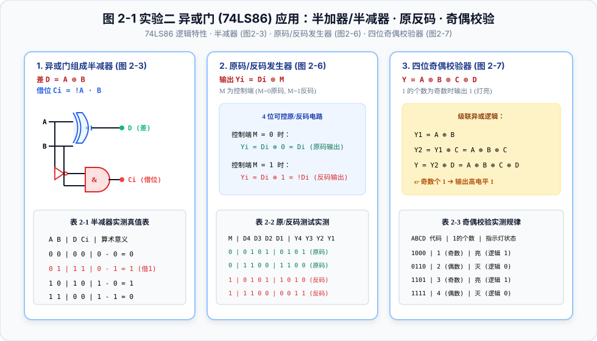
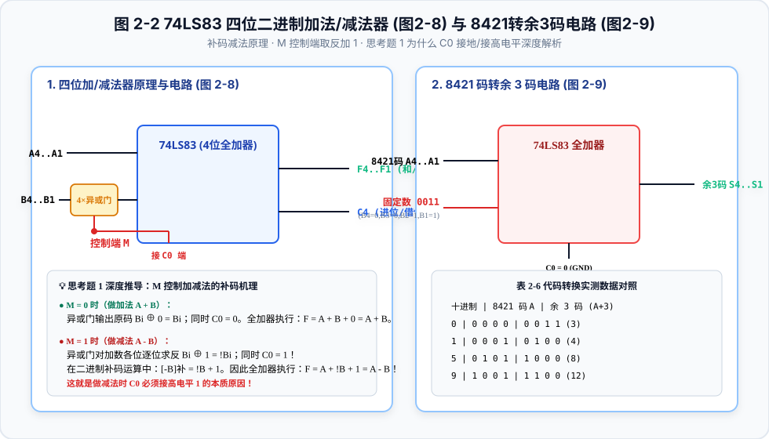

# 郑州大学 数字电子技术基础实验全攻略与图解指南 💻

> **当前分支**：`digital-circuit-lab`（数字电子技术基础实验专题分支）  
> 本分支聚焦**郑州大学（电工电子中心）**《数字电子技术基础实验》指导书核心实验——**【数电实验一：集成逻辑门电路及其应用】** 与 **【数电实验二：异或门、全加器及其应用】**，提供深度矢量图解、芯片引脚速查、摩根定律门电路转换、RC多谐振荡器频率推导、补码加减法原理及思考题标准解答。
> 
> 🏆 **已提供全套规范填报的标准实验报告（附全套真值表实测数据与 Word 文档下载）**：
> - 📄 [郑州大学_数电实验一_实验报告.md](./reports/郑州大学_数电实验一_实验报告.md) / [Word版下载](./reports/郑州大学_数电实验一_实验报告.docx)
> - 📄 [郑州大学_数电实验二_实验报告.md](./reports/郑州大学_数电实验二_实验报告.md) / [Word版下载](./reports/郑州大学_数电实验二_实验报告.docx)
> 
> 💡 **项目包含配套的本地/网页交互式学习平台**：直接在浏览器双击打开 [`index.html`](./index.html)，即可体验**逻辑门实时真值表验证器**、**74LS83 4位二进制加减法器在线仿真器** 及 **全套实验报告 Word 下载专区**！

---

## 目录
- [一、数电实验一：集成逻辑门电路及其应用](#一数电实验一集成逻辑门电路及其应用)
  - [1.1 常用集成门电路芯片引脚排列与功能（图 1-1）](#11-常用集成门电路芯片引脚排列与功能图-1-1)
  - [1.2 利用与非门构成或门、或非门及异或门（图 1-2）](#12-利用与非门构成或门或非门及异或门图-1-2)
  - [1.3 反相器多谐振荡器与三态门总线应用（图 1-3）](#13-反相器多谐振荡器与三态门总线应用图-1-3)
  - [1.4 四人智力抢答器与基本 RS 触发器逻辑（图 1-4）](#14-四人智力抢答器与基本-rs-触发器逻辑图-1-4)
  - [1.5 数电实验一 思考题标准解答](#15-数电实验一-思考题标准解答)
- [二、数电实验二：异或门、全加器及其应用](#二数电实验二异或门全加器及其应用)
  - [2.1 异或门基础与半减器、原/反码、奇偶校验（图 2-1）](#21-异或门基础与半减器原反码奇偶校验图-2-1)
  - [2.2 四位二进制全加器/减法器与 8421转余3码（图 2-2）](#22-四位二进制全加器减法器与-8421转余3码图-2-2)
  - [2.3 补码减法器 C0 接高电平 1 原理推导（思考题 1 深度突破）](#23-补码减法器-c0-接高电平-1-原理推导思考题-1-深度突破)
  - [2.4 数电实验二 思考题标准解答](#24-数电实验二-思考题标准解答)
- [三、全套实验报告与实测真值表汇总](#三全套实验报告与实测真值表汇总)

---

## 一、数电实验一：集成逻辑门电路及其应用

### 1.1 常用集成门电路芯片引脚排列与功能（图 1-1）

电路采用标准双列直插式 DIP-14 封装：

- **74LS00（四 2 输入与非门）**：$Y = \overline{A \cdot B}$。只要输入有 0 输出即为 1；全 1 才出 0。
- **74LS20（双 4 输入与非门）**：$Y = \overline{A \cdot B \cdot C \cdot D}$。
- **74LS04（六反相器）**：$Y = \bar{A}$。缓冲驱动与反相逻辑。
- **74LS125（四三态总线缓冲门）**：低电平有效使能端 $\overline{E_N}$。
  - $\overline{E_N} = 0 \implies Q = A$（导通传输）；
  - $\overline{E_N} = 1 \implies Q$ 为**高阻态（Hi-Z）**，实现与总线断开。

> [!TIP]
> **TTL 输入端悬空处理规范**：TTL 输入端悬空相当于逻辑 1，但容易引入空间电磁杂波；实验中多余的不用输入端应接 $+5\text{V}$、经电阻拉高或与有效输入端并联，严禁随意悬空。

---

### 1.2 利用与非门构成或门、或非门及异或门（图 1-2）

基于德摩根定律（反演律），单一与非门即可实现全部组合逻辑：

1. **或门（OR）**：$Y = A + B = \overline{\bar{A} \cdot \bar{B}}$（图 1-3，3 个与非门）
2. **或非门（NOR）**：$Y = \overline{A + B} = \overline{\overline{\overline{\bar{A} \cdot \bar{B}}}}$（图 1-4，在或门输出端加 1 级反相，4 个与非门）
3. **异或门（XOR）**：$Y = A \oplus B = \overline{\overline{A \cdot \overline{AB}} \cdot \overline{B \cdot \overline{AB}}}$（图 1-5，4 个与非门）

---

### 1.3 反相器多谐振荡器与三态门总线应用（图 1-3）

#### 1. 反相器多谐振荡器（图 1-6）
- **理论振荡周期与频率**：
  $$f = \frac{1}{T} = \frac{1}{2.2RC}$$
- 实测参数：$R = 1.0\text{k}\Omega, C = 0.01\mu\text{F} \implies f_{th} = 45.45\text{kHz}$。
- 示波器实测波形：周期 $T = 22.4\mu\text{s} \implies f = 44.64\text{kHz}$，输出对称矩形波脉冲。

#### 2. 三态门 74LS125 的三大应用（图 1-7）
- **多路选择开关**：$\overline{E_N}$ 控制 2 选 1 分时轮流输出；
- **数据双向总线**：两门反向并联，使能端控制数据流动方向；
- **单向总线复用**：多个外设输出端挂在单根数据总线上，使能端互斥分时输出，彻底解决总线电平冲突短路问题。

---

### 1.4 四人智力抢答器与基本 RS 触发器逻辑（图 1-4）

- **四人抢答器自锁鉴优逻辑（图 1-8）**：
  率先抢按者产生低电平使自身指示灯点亮；同时反馈信号送至 4 输入与非门封锁其它三路输入，之后其它选手再按键毫无反应，实现绝对的“第一抢答锁定”！

---

### 1.5 数电实验一 思考题标准解答
1. **与非门什么情况下输出高电平？低电平？不用输入端如何处理？**
   - 只要输入有任意一个为 0 则输出高电平 1；所有输入全为 1 时输出低电平 0。
   - 不用输入端接 $+5\text{V}$、经电阻拉高或与有效输入端并接，严禁悬空。
2. **或非门什么情况下输出高电平？低电平？不用输入端如何处理？**
   - 所有输入全为 0 时输出高电平 1；只要有 1 则输出低电平 0。多余端必须直接接地 GND。
3. **与非门可作反相器，为何还要专用反相器（74LS04）？**
   - 专用反相器内部结构精简、单片集成 6 个单元、开关速度更快、传输延迟更小、扇出驱动与抗干扰能力更强。
4. **举出其它三态门型号：**
   - 74LS244（八同相三态单向缓冲器）、74LS245（八双向总线收发器）。

---

## 二、数电实验二：异或门、全加器及其应用

### 2.1 异或门基础与半减器、原/反码、奇偶校验（图 2-1）

- **受控反相特性**：$Y = A \oplus M$。$M=0$ 输出原码 $A$；$M=1$ 输出反码 $\bar{A}$。
- **半减器**：差数 $D = A \oplus B$，借位数 $C_i = \bar{A} \cdot B$。
- **四位奇偶校验器**：$Y = A \oplus B \oplus C \oplus D$。当输入中“1”的个数为奇数时输出 1 点亮 LED。

---

### 2.2 四位二进制全加器/减法器与 8421转余3码（图 2-2）

---

### 2.3 补码减法器 C0 接高电平 1 原理推导（思考题 1 深度突破）

计算机二进制减法采用**加补码**实现：
$$A - B = A + [-B]_补 = A + (\bar{B} + 1)$$
- **加法模式（$M = 0$）**：异或门输出 $B_i \oplus 0 = B_i$（原码），且进位输入 $C_0 = M = 0$，执行 $F = A + B + 0 = A + B$。
- **减法模式（$M = 1$）**：异或门输出 $B_i \oplus 1 = \overline{B_i}$（求反码），进位输入 $C_0 = M = 1$ **正好提供了补码运算最低位所必需的“+1”**，执行：
  $$F = A + \bar{B} + 1 = A - B$$
这是做减法时 $C_0$ 必须接高电平 1 的本质原因！

---

### 2.4 数电实验二 思考题标准解答
1. **加法运算 C0 接地 0，减法运算 C0 接 1 的原因：**
   - 减法运算由加补码实现，异或门将减数取反后，必须在最低位加 1 才能构成真补码，故 $C_0=1$ 提供该最低位加 1。
2. **比较两个四位数相等输出 1 的电路构成：**
   - 利用 4 个异或门求对应位异或，再经 4 输入与非门（74LS20）及反相器汇总，当且仅当各位逐位全相等时输出 1。

---

## 三、全套实验报告与实测真值表汇总

### 3.1 数电实验一 核心测试数据
- **74LS00 与非门真值表**：00 $\to$ 4.12V(1), 01 $\to$ 4.12V(1), 10 $\to$ 4.10V(1), 11 $\to$ 0.18V(0)
- **多谐振荡器实测频率**：实测周期 $T = 22.4\mu\text{s} \implies f = 44.64\text{kHz}$（理论 $45.45\text{kHz}$）
- 👉 [下载《数电实验一》标准 Word 报告 (.docx)](./reports/郑州大学_数电实验一_实验报告.docx)

### 3.2 数电实验二 核心测试数据
- **半减器真值表**：00 $\to$ D=0,Ci=0; 01 $\to$ D=1,Ci=1(借1); 10 $\to$ D=1,Ci=0; 11 $\to$ D=0,Ci=0
- **四位加减法器实测**：
  - 加法 $M=0$: $4 + 2 = 6$ ($0100 + 0010 = 0110, C_4=0$); $7 + 9 = 16$ ($0111 + 1001 = 0000, C_4=1$)
  - 减法 $M=1$: $4 - 2 = 2$ ($0100 - 0010 = 0010, C_4=1$ 无借位); $2 - 4 = -2$ ($0010 - 0100 = 1110, C_4=0$ 有借位)
- 👉 [下载《数电实验二》标准 Word 报告 (.docx)](./reports/郑州大学_数电实验二_实验报告.docx)

---
*Created for ZZU Digital & Analog Circuit Experiments Course | Branch: `digital-circuit-lab` | 2026*
