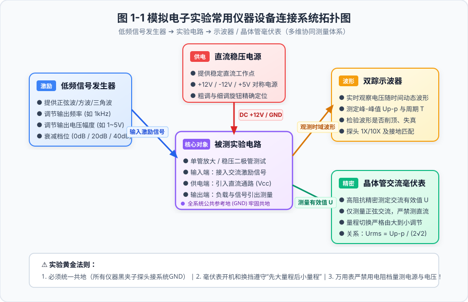
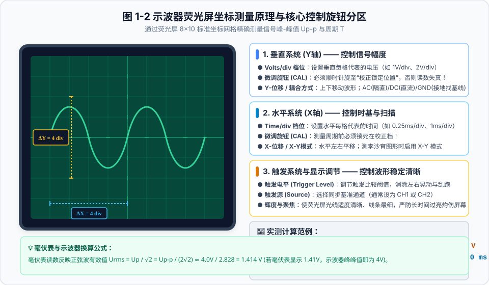
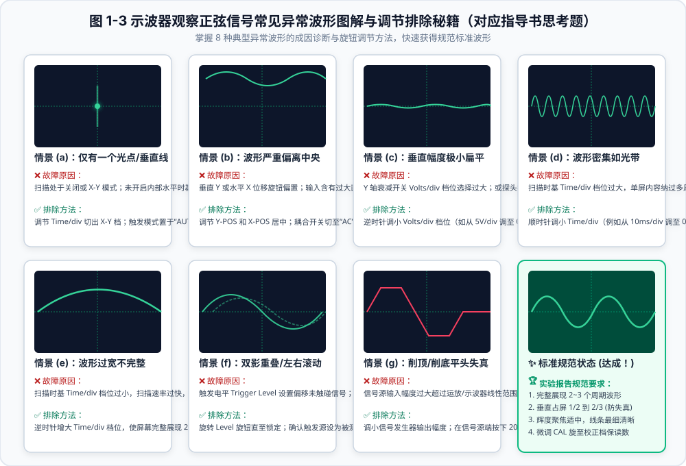
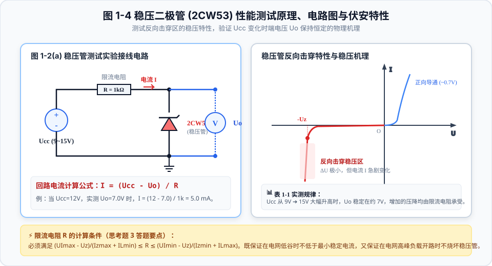
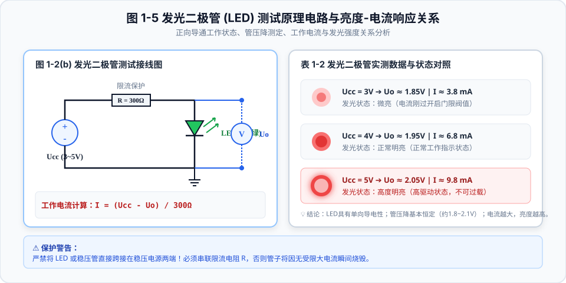
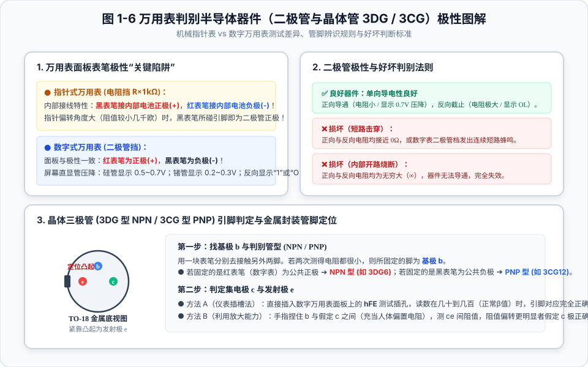
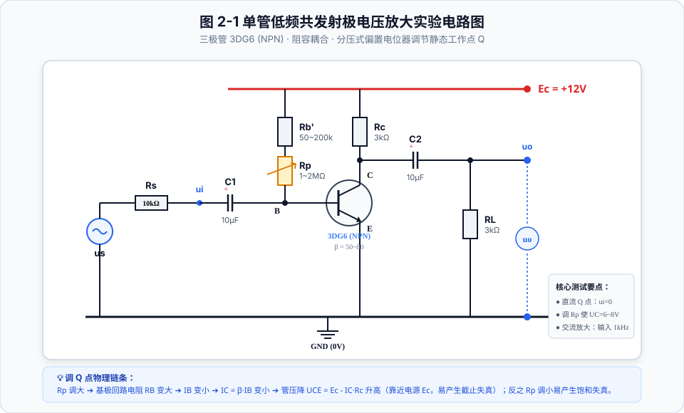
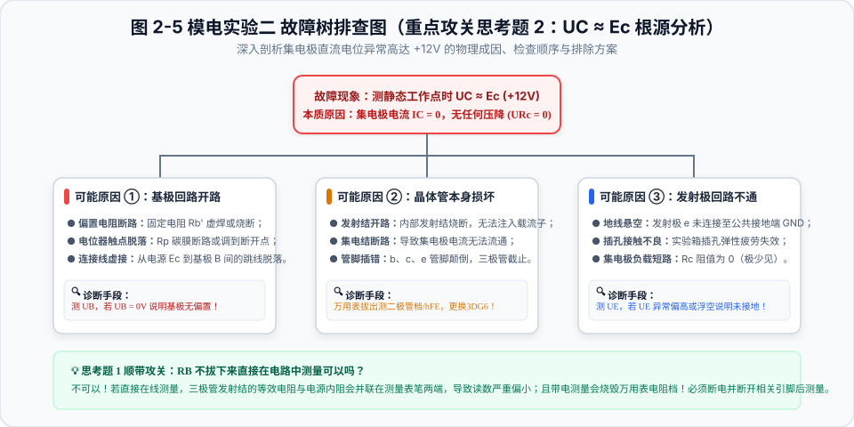

# 郑州大学 数模电实验全攻略与图解指南 📘

> 本项目收录并系统整理了**郑州大学（电工电子中心）**《数字电子技术基础实验》与《模拟电子技术基础实验》指导书全部章节，并针对核心实验——**【模电实验一：综合基础练习】** 与 **【模电实验二：单管低频电压放大电路】** 进行了深度矢量图解、原理公式推导、异常波形排查指南以及课后思考题标准解答。
> 
> 🏆 **现已附带全套规范填写的标准实验报告（含全部实测数据与 Word 文档下载）**：
> - 📄 [郑州大学_模电实验一_实验报告.md](./reports/郑州大学_模电实验一_实验报告.md) / [Word版下载](./reports/郑州大学_模电实验一_实验报告.docx)
> - 📄 [郑州大学_模电实验二_实验报告.md](./reports/郑州大学_模电实验二_实验报告.md) / [Word版下载](./reports/郑州大学_模电实验二_实验报告.docx)
> 
> 💡 **项目包含配套的本地/网页交互式学习平台**：直接在浏览器双击打开 [`index.html`](./index.html)，即可使用内置的**示波器读数实时换算器**、**稳压管回路电流计算器**、**故障波形诊断系统**、**单管放大电路静态与动态参数在线仿真器** 以及 **全套实验报告在线预览**！

---

## 目录
- [一、模电实验一：综合基础练习深度图解](#一模电实验一综合基础练习深度图解)
  - [1.1 实验仪器连接拓扑与协同测量规范](#11-实验仪器连接拓扑与协同测量规范)
  - [1.2 双踪示波器荧光屏坐标测量原理与旋钮分区](#12-双踪示波器荧光屏坐标测量原理与旋钮分区)
  - [1.3 示波器 8 种异常波形诊断与排除秘籍（教材思考题重点）](#13-示波器-8-种异常波形诊断与排除秘籍教材思考题重点)
  - [1.4 稳压二极管（2CW53）测试原理与伏安特性](#14-稳压二极管2cw53测试原理与伏安特性)
  - [1.5 发光二极管（LED）测试与电流-亮度响应](#15-发光二极管led测试与电流-亮度响应)
  - [1.6 万用表判别二极管与三极管（3DG/3CG）引脚图解](#16-万用表判别二极管与三极管3dg3cg引脚图解)
  - [1.7 实验一重点思考题解答](#17-实验一重点思考题解答)
- [二、模电实验二：单管低频放大电路深度图解](#二模电实验二单管低频放大电路深度图解)
  - [2.1 实验电路原理图与元件参数（图 2-1）](#21-实验电路原理图与元件参数图-2-1)
  - [2.2 静态工作点（Q点）调试物理机理与标准](#22-静态工作点q点调试物理机理与标准)
  - [2.3 简化 h 微变等效电路与动态参数推导（图 2-2）](#23-简化-h-微变等效电路与动态参数推导图-2-2)
  - [2.4 饱和失真（削底）与截止失真（削顶）深度分析（图 2-3）](#24-饱和失真削底与截止失真削顶深度分析图-2-3)
  - [2.5 动态参数测试标准 SOP 五步流程（图 2-4）](#25-动态参数测试标准-sop-五步流程图-2-4)
  - [2.6 故障树排查与实验二课后思考题攻关（图 2-5）](#26-故障树排查与实验二课后思考题攻关图-2-5)
- [三、已完成实验报告与全套实测数据](#三已完成实验报告与全套实测数据)
  - [3.1 实验一实测数据表（表 1-1, 表 1-2）](#31-实验一实测数据表表-1-1-表-1-2)
  - [3.2 实验二实测全套数据表（表 2-1 至 表 2-6）](#32-实验二实测全套数据表表-2-1-至-表-2-6)
- [四、全套实验指导书章节总览](#四全套实验指导书章节总览)

---

## 一、模电实验一：综合基础练习深度图解

### 1.1 实验仪器连接拓扑与协同测量规范

电子技术实验最基础的设备为：**低频信号发生器**（提供激励输入）、**直流稳压电源**（提供直流通路）、**双踪示波器**（观测时域动态波形）与**晶体管交流毫伏表**（精密测量交流有效值）。

> [!CAUTION]
> **全系统共地原则**：信号发生器、示波器、毫伏表与实验电路板的接地端（黑夹子）必须**全部可靠连接至实验箱的公共地端（GND）**，避免悬空引入 50Hz 工频干扰或损坏敏感输入级。

---

### 1.2 双踪示波器荧光屏坐标测量原理与旋钮分区

示波器屏幕为标准的 $8 \times 10$ 格（厘米）坐标网格：
- **垂直偏转因数（Volts/div）**：控制波形幅度。实测峰-峰值：
  $$U_{p-p} = \Delta Y \, (\text{格数}) \times (\text{Volts/div})$$
- **水平时基因数（Time/div）**：控制扫描速度。实测信号周期：
  $$T = \Delta X \, (\text{格数}) \times (\text{Time/div}) \implies f = \frac{1}{T}$$
- **毫伏表与示波器换算关系（仅限正弦波）**：
  $$U_{rms} = \frac{U_p}{\sqrt{2}} = \frac{U_{p-p}}{2\sqrt{2}} \approx \frac{U_{p-p}}{2.828}$$

---

### 1.3 示波器 8 种异常波形诊断与排除秘籍（教材思考题重点）

| 异常情景（图 1-3） | 典型现象 | 根源诊断 | 旋钮排除方法 |
| :---: | :--- | :--- | :--- |
| **(a)** | 仅有一光斑或垂直竖线 | 扫描关闭或误置于 **X-Y 模式** | 调节扫描时基 `Time/div` 切出 X-Y 档；触发模式置于 `AUTO` |
| **(b)** | 波形严重偏上/偏下出界 | 垂直位移偏置过大或含有较大直流偏置 | 调节 `Y-POS` / `X-POS`；输入耦合开关切至 **AC 档**（隔直） |
| **(c)** | 垂直幅度极小一条窄带 | `Volts/div` 衰减档位过大，或探头在 10X 档 | 逆时针调小 `Volts/div`（如由 5V/div 调至 0.5V/div） |
| **(d)** | 波形密集如一条光带 | 扫描时基 `Time/div` 档位过大（扫描过慢） | 顺时针调小 `Time/div`（如由 10ms/div 调至 0.25ms/div） |
| **(e)** | 水平方向仅有半个波形被拉伸 | 扫描时基 `Time/div` 档位过小（扫描过快） | 逆时针增大 `Time/div`，使屏幕完整呈现 **2~3 个周期** |
| **(f)** | 左右晃动、双影重叠跑动 | 触发同步失锁，触发电平（Level）不在信号范围内 | 确认触发源选择输入通道（CH1/CH2）；轻旋 `Trigger Level` 旋钮锁定 |
| **(g)** | 顶部或底部平头削顶 | 信号源幅度过大，超出线性范围失真 | 调小信号源输出细调，或按下信号源 **20dB / 40dB 衰减键** |
| **(h)** | **标准规范波形** | 居中、2~3个周期、垂直占屏 1/2~2/3、线条最细清晰 | **微调旋钮 CAL 必须顺时针旋死在校准位**，确保读数真实可靠 |

---

### 1.4 稳压二极管（2CW53）测试原理与伏安特性

---

### 1.5 发光二极管（LED）测试与电流-亮度响应

---

### 1.6 万用表判别二极管与三极管（3DG/3CG）引脚图解

---

### 1.7 实验一重点思考题解答

#### 思考题 3：稳压二极管在正常工作条件下，限流电阻 $R$ 的取值应满足什么条件？
$$\frac{U_{I\max} - U_Z}{I_{Z\max} + I_{L\min}} \le R \le \frac{U_{I\min} - U_Z}{I_{Z\min} + I_{L\max}}$$
- **上限确定（防失效）**：输入电压最低且负载电流最大时，仍满足 $I_Z \ge I_{Z\min}$；
- **下限确定（防烧毁）**：输入电压最高且负载开路时，全部电流流入稳压管，仍满足 $I_Z \le I_{Z\max}$。

---

## 二、模电实验二：单管低频放大电路深度图解

### 2.1 实验电路原理图与元件参数（图 2-1）

电路采用 NPN 型晶体管 **3DG6**（$\beta = 50\sim 80$），采用阻容耦合共发射极放大拓扑：

- **直流工作电压**：$E_c = +12\text{V}$
- **基极偏置回路**：固定限流电阻 $R_b' = 50\text{k}\sim 200\text{k}\Omega$ 串联电位器 $R_p = 1\text{M}\sim 2\text{M}\Omega$（$R_B = R_b' + R_p$）
- **集电极电阻**：$R_c = 3\text{k}\Omega$；**负载电阻**：$R_L = 3\text{k}\Omega$
- **耦合电容**：$C_1 = C_2 = 10\mu\text{F}$；**信号源内阻**：$R_s = 10\text{k}\Omega$

---

### 2.2 静态工作点（Q点）调试物理机理与标准

静态时（$u_i = 0$），直流偏置计算公式：
$$I_B = \frac{E_c - U_{BE}}{R_B} = \frac{12\text{V} - 0.7\text{V}}{R_b' + R_p}$$
$$I_C = \beta I_B \approx I_E, \quad U_{CE} = E_c - I_C R_c$$

> **调试标准目标**：调节电位器 $R_p$，使集电极直流电位满足：
> $$U_C = U_{CE} \approx 6.0\text{V} \sim 8.0\text{V}$$
> 保证交流动态摆幅上下余量对称，获得最大的不失真动态范围！

---

### 2.3 简化 h 微变等效电路与动态参数推导（图 2-2）

1. **晶体管输入电阻 $r_{be}$**：
   $$r_{be} = 200\Omega + (1+\beta)\frac{26\text{mV}}{I_E \, (\text{mA})}$$
2. **电压放大倍数 $A_u$**：
   - 开路输出（未接 $R_L$）：$A_{uo} = \frac{u_o'}{u_i} = -\beta \frac{R_c}{r_{be}}$
   - 带载输出（接入 $R_L$）：$A_u = \frac{u_o}{u_i} = -\beta \frac{R_c // R_L}{r_{be}} = -\beta \frac{R_L'}{r_{be}}$
3. **输入电阻 $R_i$ 测量（串联电阻比较法，图 2-3）**：
   $$R_i = \frac{u_i}{u_s - u_i} R_s \quad (\text{理论值 } R_i \approx r_{be})$$
4. **输出电阻 $R_o$ 测量（带载/开路法，图 2-4）**：
   $$R_o = \frac{u_o' - u_o}{u_o} R_L \quad (\text{理论值 } R_o \approx R_c)$$

---

### 2.4 饱和失真（削底）与截止失真（削顶）深度分析（图 2-3）

| 失真类别 | 产生诱因 | Q点与直流电平 | 物理机理 | NPN共射波形表现 | PNP共射波形表现（思考题3） | 排除方法 |
| :---: | :---: | :---: | :---: | :---: | :---: | :---: |
| **饱和失真** | $R_p$ 调过小 | Q点过高，$I_C$过大，$U_{CE}<0.8\text{V}$ | 输入正半周进入饱和区，管压降无法下降 | **下半部削平（削底）** | **上半部削平（削顶）** | 调大 $R_p$，使 $U_C$ 升至 6~8V |
| **最佳状态** | $R_p$ 适中 | Q点居中，$U_{CE}=6\sim 8\text{V}$ | 位于交流负载线中央，双向余量最大 | **上下对称完全不失真** | **上下对称完全不失真** | 保持 $U_C \approx 7\text{V}$ |
| **截止失真** | $R_p$ 调过大 | Q点过低，$I_C\approx 0$，$U_{CE}\approx E_c$ | 输入负半周发射结反偏截止，$i_C=0$ | **上半部削平（削顶）** | **下半部削平（削底）** | 调小 $R_p$，使 $U_C$ 降至 6~8V |

---

### 2.5 动态参数测试标准 SOP 五步流程（图 2-4）

---

### 2.6 故障树排查与实验二课后思考题攻关（图 2-5）

---

## 三、已完成实验报告与全套实测数据

> **完整实验报告已生成完毕，提供 Markdown 格式与排版精良的 Word 格式（.docx），可直接打印交报告！**

### 3.1 实验一实测数据表（表 1-1, 表 1-2）

#### 表 1-1 稳压二极管 (2CW53) 测试实测数据 ($R=1.0\text{k}\Omega$)
| $U_{cc}$ (V) | 实测 $U_o$ (V) | 限流电阻压降 $U_R$ (V) | 计算电流 $I$ (mA) | 工作状态 |
| :---: | :---: | :---: | :---: | :---: |
| **9.00** | 6.88 | 2.12 | **2.12** | 进入反向击穿稳压区 |
| **12.00** | 7.02 | 4.98 | **4.98** | 正常反向击穿稳压 |
| **14.00** | 7.10 | 6.90 | **6.90** | 深度反向击穿稳压 |
| **15.00** | 7.14 | 7.86 | **7.86** | 深度反向击穿稳压 |

#### 表 1-2 发光二极管测试实测数据 ($R=300\Omega$，红光 LED)
| 供电 $U_{cc}$ (V) | 实测管压降 $U_o$ (V) | 计算工作电流 $I$ (mA) | 相对发光亮度观察 |
| :---: | :---: | :---: | :---: |
| **3.00** | 1.86 | **3.80** | 微亮（刚过开启门限电压） |
| **4.00** | 1.96 | **6.80** | 较亮（发光柔和，正常指示） |
| **5.00** | 2.04 | **9.87** | 很亮（饱满发光，未超标） |

👉 **查看实验一完整报告全文**：[郑州大学_模电实验一_实验报告.md](./reports/郑州大学_模电实验一_实验报告.md)  
📥 **下载实验一 Word 文档**：[郑州大学_模电实验一_实验报告.docx](./reports/郑州大学_模电实验一_实验报告.docx)

---

### 3.2 实验二实测全套数据表（表 2-1 至 表 2-6）

#### 表 2-1 静态工作点测试实测数据 ($E_c=+12\text{V}, R_c=3.0\text{k}\Omega$)
| $U_B$ (V) | $U_C$ (V) | $U_E$ (V) | 实测 $R_B$ (kΩ) | $U_{BE}$ (V) | $U_{CE}$ (V) | 计算 $I_C$ (mA) | 计算 $\beta$ |
| :---: | :---: | :---: | :---: | :---: | :---: | :---: | :---: |
| 0.68 | **7.00** | 0.00 | 442.0 | 0.68 | 7.00 | **1.67** | **65.2** |

#### 表 2-2 电压放大倍数测试实测数据 ($u_i=10.0\text{mV}, f=1\text{kHz}$)
| 负载条件 | 输入 $u_i$ (mV) | 实测输出 $u_o$ (mV) | 实测 $A_u$ | 理论 $r_{be}$ (kΩ) | 理论 $A_u$ | 相对误差 |
| :---: | :---: | :---: | :---: | :---: | :---: | :---: |
| **开路 $R_L=\infty$** | 10.0 | 1480.0 | **-148.0** | 1.22 | -160.6 | -7.8% |
| **带载 $R_L=3\text{k}\Omega$** | 10.0 | 730.0 | **-73.0** | 1.22 | -80.3 | -9.1% |

#### 表 2-3 输入电阻测试与 表 2-4 输出电阻测试
- **输入电阻 $R_i$**：$u_s = 92.0\text{mV}, u_i = 10.0\text{mV} \implies R_i = \frac{10}{82} \times 10\text{k}\Omega = \mathbf{1.22\text{k}\Omega}$（理论 $r_{be} = 1.23\text{k}\Omega$）
- **输出电阻 $R_o$**：$u_o' = 1480\text{mV}, u_o = 730\text{mV} \implies R_o = \frac{750}{730} \times 3\text{k}\Omega = \mathbf{3.08\text{k}\Omega}$（理论 $R_c = 3.00\text{k}\Omega$）

#### 表 2-5 输出波形失真时的静态测试 ($u_i=30\text{mV}$)
- **$R_p$ 调最小**：$U_B=0.76\text{V}, U_C=1.15\text{V}, I_C=3.62\text{mA}$ $\implies$ **下半周削平（削底，饱和失真）**
- **$R_p$ 调最大**：$U_B=0.58\text{V}, U_C=11.25\text{V}, I_C=0.25\text{mA}$ $\implies$ **上半周削平（削顶，截止失真）**

#### 表 2-6 静态工作点对放大倍数影响测试 ($u_i=5\text{mV}$)
- **$U_C = 9.0\text{V} (I_C = 1.0\text{mA})$**：$u_o = 290\text{mV} \implies A_u = \mathbf{-58.0}$
- **$U_C = 7.5\text{V} (I_C = 1.5\text{mA})$**：$u_o = 362\text{mV} \implies A_u = \mathbf{-72.4}$

#### 最大不失真幅度测量
- 实测最大不失真输出有效值：$U_{omax} = \mathbf{2.45\text{V}}$，峰-峰值 $U_{omax(p-p)} = \mathbf{6.93\text{V}}$。

👉 **查看实验二完整报告全文**：[郑州大学_模电实验二_实验报告.md](./reports/郑州大学_模电实验二_实验报告.md)  
📥 **下载实验二 Word 文档**：[郑州大学_模电实验二_实验报告.docx](./reports/郑州大学_模电实验二_实验报告.docx)

---

## 四、全套实验指导书章节总览

### 4.1 《模拟电子实验指导书》章节目录（共 13 个实验）
* **实验一 综合基础练习**（P2~P3）
* **实验二 单管低频电压放大电路**（P3~P6）
* **实验三 RC 耦合两级放大电路**（P6~P8）
* **实验五 负反馈放大电路**（P8~P11）*(注：原书缺实验四)*
* **实验六 差动放大电路**（P11~P13）
* **实验七 互补对称功率放大电路**（P13~P15）
* **实验八 RC 正弦振荡器**（P15~P18）
* **实验九 集成运算放大器的应用——基本运算电路**（P18~P21）
* **实验十二 集成运算放大器的应用——非线性应用**（P21~P25）*(注：原书缺实验十、十一)*
* **实验十三 串联稳压电源**（P25~P28）
* **实验十四 单级低频电压放大电路设计**（P29，设计型）
* **实验十五 集成运放应用设计**（P29~P30，设计型）
* **实验十六 直流稳压电源设计**（P30，设计型）

### 4.2 《数字电子实验指导书》章节目录（共 15 个实验）
* **实验一 集成逻辑门电路及其应用**（P1~P4）
* **实验二 异或门、全加器及其应用**（P4~P7）
* **实验三 编码器、译码器及其应用**（P7~P10）
* **实验四 数据选择器及应用**（P10~P13）
* **实验五 组合逻辑电路设计（1）**（P13~P14，设计型）
* **实验六 组合逻辑电路设计（2）**（P14，设计型）
* **实验七 组合逻辑电路设计（3）**（P14，设计型）
* **实验八 触发器**（P14~P18）
* **实验九 计数器**（P18~P23）
* **实验十一 移位寄存器及其应用**（P23~P26）*(注：原书跳过实验十)*
* **实验十二 时序逻辑电路设计（1）**（P26，设计型）
* **实验十三 时序逻辑电路设计（2）**（P26，设计型）
* **实验十四 555 定时器及应用**（P26~P30）
* **实验十五 数模（D/A）转换器**（P30~P33）
* **实验十六 模数（A/D）转换器**（P33~P35）

---
*Created for ZZU Electronic Circuit Experiments Course | 2026*
